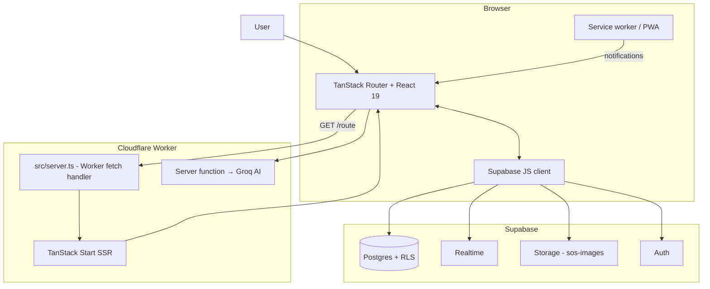

<div align="center">

# 🚨 Alertify

**Real-time disaster awareness & emergency SOS — in your pocket.**

A mobile-first web app that keeps people informed during disasters with live alerts,
an interactive map, AI-generated safety guidance, and a one-tap SOS flow — plus a
responder dashboard for emergency teams to triage incoming requests.

[](https://tanstack.com/start)
[](https://workers.cloudflare.com)
[](https://supabase.com)
[](https://tailwindcss.com)

</div>

---

## ✨ Features

| | Feature | What it does |
|---|---------|--------------|
| 🗺️ | **Live disaster map** | Leaflet-based map showing alert zones, your location, and a personalized alert radius. |
| 🔔 | **Real-time alerts feed** | Severity/distance filters, relative timestamps, and live updates via Supabase Realtime — no refresh needed. |
| 🆘 | **One-tap SOS** | Signed-in users submit an SOS with severity, message, coordinates, and an optional photo (Supabase Storage). |
| 🤖 | **AI safety guidance** | Alerts are turned into short, calm, actionable summaries by Groq (Llama 3.3 70B) via a secure server function. |
| 🚑 | **Responder dashboard** | Staff-only triage board: Active → Reviewing → Resolved, with AI-written situation notes. |
| 🔐 | **Full auth** | Email/password and Google OAuth through Supabase Auth, with automatic profile + preference creation. |
| ⚙️ | **Personal preferences** | Alert radius, minimum severity, push/sound toggles, and location sharing — stored per user. |
| 📲 | **PWA notifications** | Installable web app with a service worker for background disaster notifications, including sound cues. |
| 🌍 | **Geolocation-aware** | Distance-sorted alerts and user-position radius filtering everywhere it matters. |

## 🧭 App screens

| Route | Screen |
|-------|--------|
| `/` | Home — live status dashboard |
| `/map` | Interactive disaster map with alert zones |
| `/alerts` | Real-time alert feed with filters |
| `/sos` | Emergency SOS submission flow |
| `/responder` | Staff-only emergency responder dashboard |
| `/settings` | Account, preferences, sign out |
| `/auth` | Sign in / sign up / Google OAuth |

## 🛠 Tech stack

- **Framework** — [TanStack Start](https://tanstack.com/start) (React 19, file-based routing, SSR) with TanStack Router + Query
- **Hosting** — [Cloudflare Workers](https://workers.cloudflare.com) (SSR served from the edge via `wrangler`)
- **Backend** — [Supabase](https://supabase.com): Postgres, Auth, Realtime, Storage — no custom REST API needed
- **AI** — [Groq](https://groq.com) `llama-3.3-70b-versatile` behind a TanStack **server function** (API key never reaches the browser)
- **UI** — Tailwind CSS v4, shadcn-style components on Radix primitives, Framer Motion, Lucide icons, Sonner toasts
- **Maps** — Leaflet + react-leaflet (lazy-loaded client-side)
- **Notifications** — Service worker (`public/alertify-sw.js`) + PWA manifest for push-style alerts and sounds

## 🏗 How it works



1. The **Worker** receives `GET /…` and hands it to **TanStack Start** for SSR — HTML streams back, then the app hydrates.
2. The browser talks to **Supabase directly** for reads, writes, auth, storage, and realtime subscriptions — protected by Row Level Security.
3. AI summaries run through a **server function** so `GROQ_API_KEY` stays server-side.

## 🚀 Getting started

### Prerequisites

- **Node.js** 20+
- A **[Supabase](https://supabase.com)** project
- (Optional) A **[Groq](https://console.groq.com)** API key for AI summaries

### 1. Clone & install

```bash
git clone https://github.com/animatrix01/alertify.ai.git
cd alertify.ai
npm install
```

### 2. Set up the Supabase database

Run the migrations against your Supabase project:

```bash
supabase link --project-ref <your-project-ref>
supabase db push
```

This creates all tables, RLS policies, triggers, enums, the `sos-images` storage bucket, and enables **Realtime** on `disaster_alerts` and `sos_reports`.

> In the Supabase dashboard, also enable the **Google** OAuth provider if you want Google sign-in.

### 3. Configure environment variables

Create a `.env` file in the project root:

```bash
# Browser (Vite build-time)
VITE_SUPABASE_URL=https://<your-project-ref>.supabase.co
VITE_SUPABASE_PUBLISHABLE_KEY=<your-anon-key>

# Server (SSR / Cloudflare Worker)
SUPABASE_URL=https://<your-project-ref>.supabase.co
SUPABASE_PUBLISHABLE_KEY=<your-anon-key>
GROQ_API_KEY=<your-groq-api-key>          # optional — app degrades gracefully without it

# Local dev only (service worker is disabled in dev by default)
VITE_ENABLE_SW=1
```

> ⚠️ `SUPABASE_SERVICE_ROLE_KEY` is supported for the server-only admin client (`src/integrations/supabase/client.server.ts`) and **bypasses RLS — never expose it to the browser.**

### 4. Add sample alerts (optional but recommended)

There is **no automated ingestion pipeline** yet — the `disaster_alerts` table only contains what you insert. To see the map and alerts feed populated, insert a few test rows (Supabase SQL editor or `supabase db execute`):

```sql
insert into public.disaster_alerts (type, severity, title, description, latitude, longitude, radius_km, source, expires_at) values
  ('flood',     'critical', 'Flash flood warning',       'Rapid water level rise along the river. Move to higher ground immediately.', 28.6139, 77.2090, 15, 'test', now() + interval '12 hours'),
  ('earthquake','warning',  'M5.4 seismic event',        'Moderate shaking reported. Check for structural damage before re-entering buildings.', 35.6895, 139.6917, 50, 'test', now() + interval '6 hours'),
  ('wildfire',  'advisory', 'Wildfire spreading NW',     'Smoke visible from town. Keep windows closed and monitor local guidance.', 37.7749, -122.4194, 25, 'test', now() + interval '24 hours');
```

They'll appear on the map and feed instantly thanks to the Realtime subscription.

### 5. Run it

```bash
npm run dev        # start the dev server
```

Open the printed local URL (typically `http://localhost:5173`) on desktop or a phone — the UI is mobile-first.

## 🧰 Troubleshooting

| Symptom | Cause & fix |
|---------|-------------|
| `Missing Supabase environment variable(s)` thrown at startup | One of `VITE_SUPABASE_URL` / `VITE_SUPABASE_PUBLISHABLE_KEY` isn't set. Copy `.env.example` → `.env` and restart the dev server. |
| Map page blank or SSR error mentioning `window` | Leaflet only runs in the browser — it's lazy-loaded on `/map`. If you add new map components, keep them client-only (mount after hydration). |
| No notification prompts / sounds in dev | The service worker is **disabled in dev** so it doesn't fight HMR. Set `VITE_ENABLE_SW=1` and restart. |
| Google sign-in fails or redirects to an error | Enable the Google provider in Supabase Auth settings and add your app URL to the allowed redirect URLs. |
| Alerts feed is empty | Nothing ingests alerts automatically — see step 4 to insert sample data. |
| AI summaries show the raw description | `GROQ_API_KEY` isn't set (or is invalid). Without it the app degrades gracefully to the original alert text. |

## 📦 Scripts

| Command | What it does |
|---------|--------------|
| `npm run dev` | Start the Vite dev server |
| `npm run build` | Production build (Cloudflare Worker output) |
| `npm run build:dev` | Production build in development mode |
| `npm run preview` | Preview the production build locally |
| `npm run lint` | Run ESLint |
| `npm run format` | Format with Prettier |

## ☁️ Deploy to Cloudflare Workers

The repo is already wired for Workers (`wrangler.jsonc` → `main: src/server.ts`):

```bash
npx wrangler deploy
```

Set your production environment variables (`SUPABASE_URL`, `SUPABASE_PUBLISHABLE_KEY`, `GROQ_API_KEY`) as Worker secrets:

```bash
npx wrangler secret put SUPABASE_URL
npx wrangler secret put SUPABASE_PUBLISHABLE_KEY
npx wrangler secret put GROQ_API_KEY
```

## 🗂 Project structure

```
alertify.ai/
├── src/
│   ├── routes/                 # File-based routes (/, /map, /alerts, /sos, /responder, /settings, /auth)
│   ├── components/
│   │   ├── layout/             # AppShell, TopBar, BottomNav
│   │   ├── map/                # Leaflet disaster map
│   │   ├── notifications/      # Alert notification manager
│   │   ├── settings/           # Settings components
│   │   └── ui/                 # shadcn-style UI primitives
│   ├── hooks/                  # Auth, geolocation, alerts, preferences, SOS, staff role…
│   ├── services/
│   │   ├── ai/                 # Groq AI alert summaries (server function)
│   │   └── notifications/      # Service worker registration, sounds, dedupe, severity priority
│   ├── integrations/supabase/  # Typed client, admin client, auth middleware, generated types
│   ├── lib/                    # Utilities, SSR error handling
│   ├── server.ts               # Cloudflare Worker entry
│   ├── start.ts                # TanStack Start instance + server middleware
│   └── styles.css              # Tailwind v4 + theme tokens
├── supabase/migrations/        # SQL schema, RLS policies, triggers, realtime, storage
├── public/
│   ├── alertify-sw.js          # Service worker for notifications
│   ├── manifest.webmanifest    # PWA manifest
│   ├── sounds/                 # Alert sound cues
│   └── images/
└── wrangler.jsonc              # Cloudflare Workers config
```

## 🗃 Data model

| Table | Purpose | Access |
|-------|---------|--------|
| `disaster_alerts` | Live disaster alerts (type, severity, location, radius, expiry) | Public read, Realtime-enabled |
| `sos_reports` | Emergency SOS submissions with status lifecycle | Owner-only (RLS) |
| `profiles` | User display name, avatar, phone, role | Owner-only |
| `user_preferences` | Alert radius, min severity, push/sound/location toggles | Owner-only |
| `emergency_contacts` | Personal emergency contact list | Owner-only |
| `sos-images` (bucket) | Optional SOS photo attachments | Public read, owner write |

Enums: `alert_severity` (`info → advisory → warning → critical`), `alert_type` (earthquake, flood, wildfire, storm, tsunami, heatwave, landslide, other), `sos_status` (`active → acknowledged → resolved / cancelled`).

A `handle_new_user` trigger automatically creates a profile and default preferences for every new signup.

## 🔒 Security notes

- **Row Level Security** is enabled on every table — clients only ever read/write their own rows, and alerts are read-only.
- The **Groq API key** lives only in a server function; the client gets the generated text back, never the key.
- The **service-role key** is never shipped to the browser; use it only for trusted server-side operations.
- Responder access is checked via the `useStaffRole` hook (email allow-list for the demo + `profiles.role` for future RBAC).

## 🗺 Roadmap ideas

- [ ] Automated disaster-feed ingestion (USGS, GDACS, etc.) into `disaster_alerts`
- [ ] Web Push for off-screen disaster notifications
- [ ] Responder assignment + ETA tracking on active SOS reports
- [ ] Emergency contacts integration into the SOS flow
- [ ] Full RBAC UI for responder/admin management

## 📄 License

All rights reserved © 2026 Alertify.

## 📚 Deep-dive documentation

For a full tour of how the codebase is wired — request flow, auth middleware, HTTP endpoints, and the mental model of every layer — see **[`final project overview.md`](./final%20project%20overview.md)**.

---

<div align="center">

**Built with ❤️ to help people stay safe when it matters most.**

</div>
